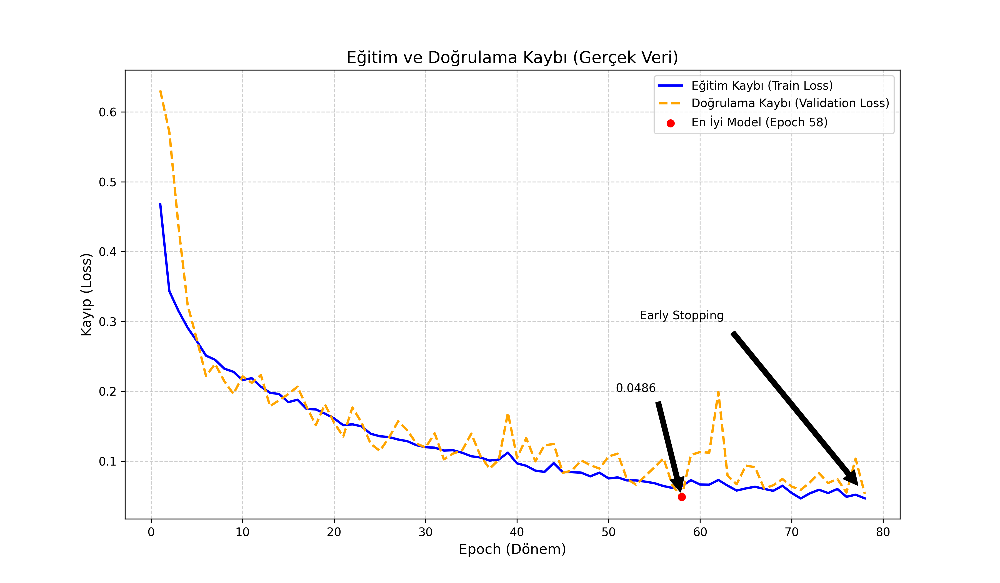
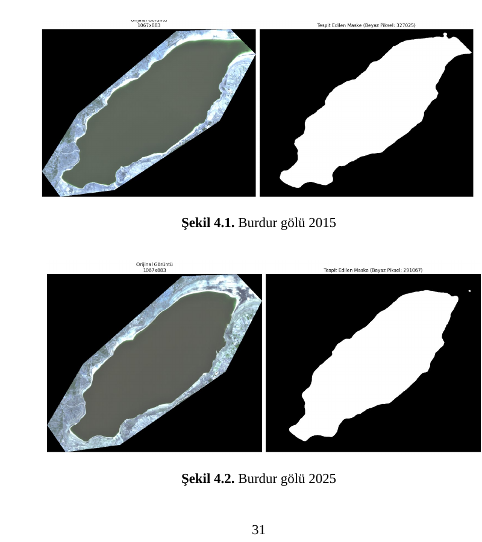

# Lake Surface Segmentation from Sentinel-2 Imagery

> Graduation project by [**Enes Bozdağ**](https://github.com/enboz21) and [**Melih Uğurlu**](https://github.com/404melih), undergraduate students in Computer Engineering at Fırat University.  
> The project was developed as an equal partnership: both co-authors jointly contributed to the research, data workflow, implementation, experimentation, and documentation.

An end-to-end remote-sensing and deep-learning pipeline for detecting lake and inland-water surfaces in **Sentinel-2 multispectral imagery**. The project downloads selected satellite bands for defined geographic regions, builds georeferenced four-band GeoTIFF inputs, creates water masks, and runs a U-Net model to produce georeferenced segmentation outputs.

The repository is kept as the original graduation-project implementation and includes a trained checkpoint, sample data, example predictions, and the training-loss artifact.



## Why this project matters

Monitoring water bodies from satellite imagery is useful for environmental observation and change analysis. This project combines a conventional spectral-index approach with semantic segmentation so that the data-collection, preprocessing, training/evaluation, and inference stages can be demonstrated in one reproducible codebase.

## Highlights

- Downloads Sentinel-2 L2A bands for GeoJSON-defined areas and configurable date/cloud-cover filters.
- Standardizes imagery into georeferenced **4-band GeoTIFF** inputs: Red (B04), Green (B03), Blue (B02), and SWIR (B11).
- Generates initial water labels using NDWI-based thresholding and contour-based cleanup.
- Uses a 4-channel U-Net implemented with PyTorch for binary water segmentation.
- Saves predictions as georeferenced, LZW-compressed GeoTIFF masks.
- Includes an evaluation script for IoU, Dice score, and pixel accuracy.
- Includes sample data, model weights, and loss visualizations for inspection.

## Results reported in the thesis

The accompanying graduation thesis reports the following evaluation results for the trained model on the project dataset:

| Metric | Reported result |
| --- | ---: |
| IoU (Intersection over Union) | 97.29% |
| Dice score | 98.40% |
| Pixel accuracy | 98.13% |

The thesis also reports an average inference time of **4.2 seconds** for a standard 100 km² Sentinel-2 tile (10,980 × 10,980 pixels) on an NVIDIA RTX 5060 Ti (16 GB). These values are thesis-reported results; rerun `scripts/evaluation/evaluate_model.py` to independently reproduce metrics in a local environment.

### Example segmentation result

The comparison below shows the original satellite imagery (left) and the generated water masks (right) for Burdur Lake in 2015 and 2025.



## Pipeline

```text
GeoJSON areas + Sentinel-2 L2A products
              |
              v
Download selected bands ──> Merge/resample bands ──> 4-band GeoTIFF
              |                                           |
              v                                           v
NDWI + contour cleanup ───────────────────────────> training masks
                                                          |
                                                          v
                                               PyTorch U-Net training
                                                          |
                                                          v
                                             georeferenced water-mask output
```

## Verified project artifacts

The repository currently contains the following versioned artifacts:

| Artifact | What is included |
| --- | --- |
| Training dataset | 69 paired `*_rgb_nir.tif` inputs and `*_mask.tif` masks |
| Areas of interest | 12 GeoJSON files |
| Prepared imagery | 22 merged four-band GeoTIFFs |
| Example outputs | 4 predicted water masks in `outputs/` |
| Model checkpoint | `gol_bulucu_unet_sentinel.pth` |
| Training trace | 78 epochs; lowest logged validation loss **0.0486** at epoch **58** |

The loss values above come from the logged training trace in `scripts/analysis/plot_training_loss.py`. They are not segmentation-quality metrics. Run the evaluation script to report IoU, Dice, and accuracy for the dataset available on your machine.

## Repository layout

```text
.
├── dataset/                         # Paired 4-band images and masks
├── outputs/                         # Example U-Net prediction masks
├── notebooks/
│   ├── training.ipynb               # Original training notebook
│   └── exploration.ipynb            # Exploratory notebook
├── scripts/
│   ├── inference/                   # Single-image inference example
│   ├── evaluation/                  # IoU, Dice, accuracy evaluation
│   ├── data_pipeline/               # Download, merge, mask, vectorize
│   ├── analysis/                    # Training-loss visualization
│   └── utilities/                   # GPU and band inspection helpers
├── veriCekme+maskeleme/
│   ├── geojsons/                    # Areas of interest
│   └── ayarlar.txt                  # Download filters
├── gol_bulucu_unet_sentinel.pth     # Trained U-Net weights (Git LFS)
├── gol_pixel_sayici.py              # Command-line inference
├── calistir.bat                     # Windows CPU inference launcher
└── calistirgpu.bat                  # Windows GPU inference launcher
```

## Tech stack

Python · PyTorch · Rasterio/GDAL · NumPy · OpenCV · Sentinel-2 · Copernicus Data Space Ecosystem · GeoTIFF · GeoJSON

## Quick start

### 1. Clone the repository and fetch large files

The GeoTIFF files and model checkpoint are tracked with Git LFS.

```powershell
git lfs install
git clone https://github.com/enboz21/Firat_uni_Bitirme_projesi.git
cd Firat_uni_Bitirme_projesi
git lfs pull
```

### 2. Create an environment and install dependencies

```powershell
python -m venv .venv
.\.venv\Scripts\Activate.ps1
python -m pip install --upgrade pip
pip install -r requirements.txt
```

For a CUDA-enabled PyTorch installation, install the appropriate build from the [official PyTorch selector](https://pytorch.org/get-started/locally/) before installing `requirementsgpu.txt`.

### 3. Run inference

The command-line inference script accepts a GeoTIFF path and writes a mask to `outputs/`.

```powershell
python gol_pixel_sayici.py "burdur_01_2025_merged.tif"
```

On Windows, the CPU launcher can also create a local virtual environment automatically:

```powershell
.\calistir.bat "burdur_01_2025_merged.tif"
```

### 4. Evaluate the included dataset

```powershell
python scripts/evaluation/evaluate_model.py
```

This calculates mean IoU, Dice score, and pixel accuracy across paired images and masks in `dataset/`.

## Data preparation workflow

1. Add or edit an area of interest under `veriCekme+maskeleme/geojsons/`.
2. Set date, cloud-cover, and band filters in `veriCekme+maskeleme/ayarlar.txt`.
3. Configure Copernicus S3 credentials as environment variables (see below), then run `scripts/data_pipeline/download_sentinel.py`.
4. Run `scripts/data_pipeline/merge_bands.py` to merge and resample the selected bands.
5. Run `scripts/data_pipeline/generate_ndwi_mask.py` to create NDWI-based water masks, or `scripts/data_pipeline/mask_to_geojson.py` to export vector masks.

## Credentials and security

The download script reads Copernicus S3 credentials from the environment; it does not require credentials in source code.

```powershell
$env:CDSE_S3_ACCESS_KEY = "your-access-key"
$env:CDSE_S3_SECRET_KEY = "your-secret-key"
python .\scripts\data_pipeline\download_sentinel.py
```

If the repository was previously public while credentials were committed, revoke and rotate those keys in the provider dashboard before relying on them again.

## Reproducibility notes

- The included model is an inference artifact. The repository does not currently contain a standalone training script; the original training work is preserved in `notebooks/training.ipynb`.
- The prediction scripts resize an input to the model resolution before inference and resize the result back to the input raster dimensions.
- The NDWI workflow is a label-generation/preprocessing stage, while U-Net is the learned segmentation stage.
- Exact results may vary across PyTorch, CUDA, and GDAL/Rasterio versions.

## Contributors

- [**Enes Bozdağ**](https://github.com/enboz21) — Co-author, Computer Engineering student at Fırat University; equal contributor across research, data preparation, implementation, experimentation, and documentation.
- [**Melih Uğurlu**](https://github.com/404melih) — Co-author, Computer Engineering student at Fırat University; equal contributor across research, data preparation, implementation, experimentation, and documentation.

This was a fully shared project; the descriptions above intentionally do not assign ownership of a specific module to only one contributor. Profile links and academic details can be added when confirmed.

## Academic advisor

**Prof. Dr. İlhan Aydın** — Head of the Software Department (Yazılım Anabilim Dalı Başkanı)

## CV-ready description

**Lake Surface Segmentation from Sentinel-2 Imagery** — Built an end-to-end remote-sensing pipeline that downloads and preprocesses Sentinel-2 multispectral data, generates georeferenced four-band GeoTIFF inputs, and applies a PyTorch U-Net to segment lake/water surfaces. Implemented raster preprocessing, NDWI-based mask generation, GeoTIFF output, and IoU/Dice/accuracy evaluation tooling.

## License

This project is licensed under the [MIT License](LICENSE).
